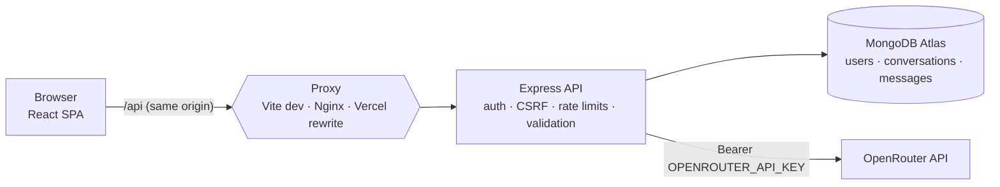

# Ava — Minimal AI Customer Support Agent

A full-stack customer-support chat application. Users sign up, chat with an AI support assistant ("Ava") powered by [OpenRouter](https://openrouter.ai), and come back later to their saved conversation history. Built with React + Vite, Node.js + Express, MongoDB Atlas and JWT cookie authentication.

> **Status (see [`docs/FINAL-ASSESSMENT-REPORT.md`](docs/FINAL-ASSESSMENT-REPORT.md))** — Application, automated tests (server + client), security audit, Docker files and deployment configuration are complete. **Live demo: [assesment-virallens.vercel.app](https://assesment-virallens.vercel.app)** (frontend on Vercel, API on Render free tier — the first request after ~15 min of inactivity can take up to a minute while the API wakes up). Verified end to end against MongoDB Atlas with real OpenRouter replies. Docker runtime has **not** been verified (Docker was not available in the build environment).

---

## Contents
1. [Features](#features)
2. [Architecture](#architecture)
3. [Tech stack](#tech-stack)
4. [Project structure](#project-structure)
5. [Prerequisites](#prerequisites)
6. [MongoDB Atlas setup](#mongodb-atlas-setup)
7. [OpenRouter setup](#openrouter-setup)
8. [Environment variables](#environment-variables)
9. [Run locally](#run-locally)
10. [Testing](#testing)
11. [Docker](#docker)
12. [API summary](#api-summary)
13. [Security](#security)
14. [Deployment (Render + Vercel)](#deployment-render--vercel)
15. [Troubleshooting](#troubleshooting)
16. [GitHub submission](#github-submission)
17. [Known limitations](#known-limitations)

---

## Features
**Authentication**
- Sign up, log in, log out; session restored on page refresh.
- Passwords hashed with bcrypt; JWT stored in an **HttpOnly** cookie (never readable by JavaScript).
- CSRF protection (server-issued double-submit token), rate-limited auth endpoints, generic login errors.

**Chat**
- Chat with an AI support assistant; the conversation context (recent messages) is sent with every request.
- Messages and replies are persisted in MongoDB; conversations get a title from the first message.
- Sidebar with conversation history (most recent first, "Load more"), open/continue any past conversation, delete with confirmation.
- Optimistic sending, typing indicator, failed-message state with **Retry** (idempotent — no duplicate messages), suggested prompts, Markdown replies with code blocks and copy buttons, mobile drawer layout.
- Strict per-user data isolation: another user's conversation URL shows "Conversation not found".

**AI integration (server-side only)**
- OpenRouter Chat Completions via native `fetch`; configurable model and system prompt.
- Timeout per attempt, retries with exponential backoff on 408/429/5xx/network errors (honours `Retry-After`), no retry on auth errors, mapped error codes.
- If the AI call fails, the user message is rolled back so history never contains unanswered turns.

---

## Architecture

- The browser always calls **`/api` on its own origin**; a proxy forwards it to the API. This keeps the auth cookie first-party (`SameSite=Lax` works, third-party-cookie blocking does not break login).
- The OpenRouter key lives **only** in the server environment.
- Send flow: auth → CSRF → rate limit → validate → per-conversation lock → find/create conversation (filtered by user) → save user message → load recent context → OpenRouter (timeout + retry) → save assistant reply → respond.

Design documents live in [`docs/`](docs) (architecture, database, API, security, AI, Docker, decision log).

## Tech stack
| Layer | Technology |
|---|---|
| Frontend | React 19, Vite 8, Tailwind CSS 4, React Router 7, Axios, Context API, react-markdown |
| Backend | Node.js 24, Express 5, Mongoose 9, Zod 4, jsonwebtoken, bcrypt, Helmet, CORS, express-rate-limit |
| Database | MongoDB Atlas |
| AI | OpenRouter (default model `openai/gpt-4o-mini`) |
| Testing | Vitest, Supertest, mongodb-memory-server, Testing Library (jsdom) |
| DevOps | Docker, Docker Compose, Nginx (unprivileged), Render (API), Vercel (frontend) |

## Project structure
```
├── client/                     React + Vite SPA
│   ├── src/api/                Axios instance (CSRF + 401 handling), auth/chat API modules
│   ├── src/context/            AuthContext, ChatContext
│   ├── src/components/         auth/, chat/ (Sidebar, MessageList, MessageBubble, ChatInput…), common/
│   ├── src/pages/              Login, Signup, Chat, NotFound
│   ├── Dockerfile, nginx.conf, vercel.json, .env.example
├── server/                     Express API
│   ├── src/config/             env validation (Zod), MongoDB connection
│   ├── src/middleware/         auth, CSRF, validation, rate limiters, errors, logging
│   ├── src/models/             User, Conversation, Message
│   ├── src/services/           auth, chat, OpenRouter client
│   ├── src/controllers/, src/routes/, src/validators/
│   ├── tests/                  Vitest + Supertest suites
│   ├── scripts/smoke-openrouter.js   live OpenRouter check
│   ├── Dockerfile, .env.example
├── docs/                       requirements, architecture, API, security, progress tracker, decision log
├── docker-compose.yml
└── render.yaml
```

## Prerequisites
- **Node.js 24** (minimum 22.12; see `engines`) and npm.
- A **MongoDB Atlas** cluster (free tier is fine).
- An **OpenRouter** API key.
- Optional: Docker Engine + Docker Compose v2.

## MongoDB Atlas setup
1. Create a free cluster at [cloud.mongodb.com](https://cloud.mongodb.com).
2. **Database Access** → add a database user with a strong password (role: *Read and write to any database*).
3. **Network Access** → add your current IP (and later your Render egress, or `0.0.0.0/0` with a strong password).
4. **Connect → Drivers** → copy the `mongodb+srv://…` string, insert the password and add a database name, e.g.
   `mongodb+srv://<user>:<password>@<cluster>.mongodb.net/ai_support?retryWrites=true&w=majority`.
5. Put it in `server/.env` as `MONGODB_URI`. Collections and indexes are created automatically on first start.

## OpenRouter setup
1. Sign in at [openrouter.ai](https://openrouter.ai) and create a key under **Keys** (it starts with `sk-or-`).
2. Add credits if the chosen model is not free.
3. Put it in `server/.env` as `OPENROUTER_API_KEY`. Optionally change `OPENROUTER_MODEL` (any OpenRouter model id).
4. Check it: `cd server && npm run smoke:ai` sends one real request and prints the reply or the mapped error.

## Environment variables
Copy the examples and fill in the secrets — `.env` files are git-ignored:
```bash
cp server/.env.example server/.env
cp client/.env.example client/.env      # optional, defaults are fine
```
Generate a JWT secret:
```bash
node -e "console.log(require('crypto').randomBytes(48).toString('hex'))"
```

### Server (`server/.env`)
| Variable | Required | Default | Description |
|---|---|---|---|
| `MONGODB_URI` | **yes** | – | Atlas connection string (`mongodb+srv://…`) |
| `JWT_SECRET` | **yes** | – | ≥ 32 random characters |
| `OPENROUTER_API_KEY` | **yes** | – | OpenRouter key (server-side only) |
| `NODE_ENV` | no | `development` | `development` / `production` / `test` |
| `PORT` | no | `5000` | API port |
| `TRUST_PROXY` | no | `0` | Number of reverse proxies in front of the API (`1` behind Nginx/Render) |
| `CLIENT_ORIGIN` | no | `http://localhost:5173` | Comma-separated allowed browser origins (CORS) |
| `JWT_EXPIRES_IN` | no | `7d` | Session lifetime (`15m`, `12h`, `7d`) |
| `BCRYPT_SALT_ROUNDS` | no | `12` | bcrypt cost |
| `COOKIE_SECURE` | no | `true` in production | Must be `true` behind HTTPS |
| `COOKIE_SAMESITE` | no | `lax` | `lax` / `strict` / `none` (`none` requires `COOKIE_SECURE=true`) |
| `OPENROUTER_MODEL` | no | `openai/gpt-4o-mini` | Model id |
| `OPENROUTER_BASE_URL` | no | `https://openrouter.ai/api/v1` | API base URL |
| `OPENROUTER_APP_URL` / `OPENROUTER_APP_NAME` | no | localhost / app name | Attribution headers sent to OpenRouter |
| `AI_SYSTEM_PROMPT` | no | built-in support persona | Override the system prompt |
| `AI_TIMEOUT_MS` | no | `30000` | Timeout per attempt |
| `AI_MAX_RETRIES` | no | `2` | Retries after the first attempt |
| `AI_MAX_TOKENS` / `AI_TEMPERATURE` | no | `1024` / `0.3` | Generation settings |
| `AI_CONTEXT_MESSAGES` / `AI_CONTEXT_MAX_CHARS` | no | `20` / `12000` | Conversation context budget |
| `RATE_LIMIT_WINDOW_MS` / `RATE_LIMIT_MAX` | no | 15 min / `300` | Global per-IP limit on `/api` |
| `AUTH_RATE_LIMIT_MAX` | no | `20` | Signup + login per IP per window |
| `CHAT_RATE_LIMIT_WINDOW_MS` / `CHAT_RATE_LIMIT_MAX` | no | 1 min / `20` | Messages per user per window |

Invalid or missing values stop the server at startup with a list of the offending **key names** (values are never printed).

### Client (`client/.env`)
| Variable | Default | Description |
|---|---|---|
| `VITE_API_BASE_URL` | `/api` | API base URL seen by the browser. Keep `/api` when proxied. **Never put secrets in `VITE_*`** — they are embedded in the bundle. |
| `VITE_PROXY_TARGET` | `http://localhost:5000` | Dev/preview only: where Vite forwards `/api` |

## Run locally
```bash
git clone <your-repo-url> && cd <repo>
cd server && npm install && cp .env.example .env    # fill MONGODB_URI, JWT_SECRET, OPENROUTER_API_KEY
npm run dev                                          # API on http://localhost:5000

# second terminal
cd client && npm install
npm run dev                                          # app on http://localhost:5173 (proxies /api → :5000)
```
Open <http://localhost:5173>, create an account and start chatting. `GET http://localhost:5000/api/health` reports API and database status.

Production build of the client: `cd client && npm run build && npm run preview` (preview also proxies `/api`).

## Testing
```bash
cd server && npm test     # Vitest + Supertest against a real in-memory MongoDB (downloads a mongod binary on first run)
cd client && npm test     # Vitest + Testing Library (jsdom)
cd client && npm run build
cd server && npm run smoke:ai   # optional live OpenRouter check (needs a real key)
```
- **Server (159 tests):** env validation, app middleware (CORS, Helmet, body limits, caching headers, logging), auth (cookies, JWT edge cases, CSRF, rate limits), models and indexes, OpenRouter client (retry, timeout, error mapping, context), send flow (rollback, idempotency, concurrency), history/isolation, and a security suite (401 on every protected route, NoSQL injection, mass assignment, prototype pollution, secret leakage, production cookie flags).
- **Client (59 tests):** validators, HTTP client (CSRF, retries, 401 handling, timeout), auth pages and route guards, chat dashboard flows (send, retry, rapid switching, delete, mobile drawer, logout), Markdown safety.
- The AI provider is mocked **only in tests**; the application always calls the real OpenRouter API.

## Docker
```bash
cp server/.env.example server/.env    # Atlas URI, JWT secret, OpenRouter key
docker compose up --build              # http://localhost:8080
docker compose ps                      # both services should become "healthy"
docker compose logs -f server
docker compose down
```
- `server`: Node 24 Alpine, production dependencies only, non-root `node` user, health check on `/api/health`, graceful shutdown on `SIGTERM`. Port 5000 is internal only.
- `client`: static build served by unprivileged Nginx on port 8080; `/api/` is proxied to the `server` service (120 s timeout for AI calls), SPA fallback, security headers.
- MongoDB is Atlas (no database container); the server needs outbound internet access and an Atlas IP allow-list entry for your machine.
- Compose sets `COOKIE_SECURE=false` only because local Docker is plain HTTP.

> The Docker files were written and their build inputs checked (production-only install boots, client builds from the Docker context), but `docker compose up` has **not** been run: Docker was not available in the build environment.

## API summary
Base path `/api`, JSON envelope `{ success, data, meta? }` / `{ success: false, error: { code, message, details? } }`. All `POST`/`DELETE` requests need the `X-CSRF-Token` header (token from `GET /api/auth/csrf-token`). Full specification: [`docs/04-API-SPECIFICATION.md`](docs/04-API-SPECIFICATION.md).

| Method | Path | Auth | Description |
|---|---|---|---|
| GET | `/api/health` | – | API + database status |
| GET | `/api/auth/csrf-token` | – | Issue CSRF token (cookie + body) |
| POST | `/api/auth/signup` | – | Create account, start session |
| POST | `/api/auth/login` | – | Log in |
| POST | `/api/auth/logout` | – | End session |
| GET | `/api/auth/me` | ✔ | Current user |
| POST | `/api/chat/send` | ✔ | Send a message, get the AI reply (creates a conversation if none given) |
| GET | `/api/chat/history` | ✔ | Paginated conversation list |
| GET | `/api/chat/conversations/:id` | ✔ | One conversation |
| GET | `/api/chat/conversations/:id/messages` | ✔ | Messages (cursor pagination) |
| DELETE | `/api/chat/conversations/:id` | ✔ | Delete a conversation and its messages |

## Security
- bcrypt password hashing; `passwordHash` is never selected or returned.
- JWT (HS256, pinned) in an `HttpOnly`, `SameSite=Lax`, `Secure` (production) cookie; user loaded from the database on every request.
- CSRF double-submit token on all state-changing requests; CORS allow-list; Helmet headers; `Cache-Control: no-store` on API responses.
- Rate limits: global per IP, auth per IP, chat per user.
- Zod strict validation of every body, query and id → NoSQL operator injection and mass assignment are rejected.
- Every conversation/message query is scoped to the authenticated user; other users' resources return 404.
- OpenRouter key and other secrets exist only in the server environment; the built client bundle is checked to contain no secrets.
- AI output is rendered as Markdown without raw HTML; unsafe link protocols are stripped.
Details: [`docs/08-SECURITY-REQUIREMENTS.md`](docs/08-SECURITY-REQUIREMENTS.md).

## Deployment (Render + Vercel)
The frontend (Vercel) proxies `/api/*` to the API (Render), so the browser only ever talks to the Vercel domain.

**1. API on Render**
1. Push the repository to GitHub.
2. Render → **New → Blueprint** → select the repo (uses [`render.yaml`](render.yaml)), or create a Web Service with root directory `server`, build `npm ci --omit=dev`, start `node src/server.js`, health check `/api/health`.
3. Set the secret env vars in the dashboard: `MONGODB_URI`, `OPENROUTER_API_KEY` (`JWT_SECRET` is generated by the blueprint).
4. In Atlas Network Access allow Render's outbound IPs (or `0.0.0.0/0` with a strong DB password).
5. Wait for the deploy, then check `https://<render-service>.onrender.com/api/health` → `200`, `"database":"connected"`.

**2. Frontend on Vercel**
1. Edit [`client/vercel.json`](client/vercel.json): replace `REPLACE-WITH-RENDER-SERVICE` with your Render service name. Commit and push.
2. Vercel → **Add New Project** → import the repo → **Root Directory `client`** (framework Vite, build `npm run build`, output `dist`). Leave `VITE_API_BASE_URL` unset.
3. Deploy and note the domain (e.g. `https://ava-support.vercel.app`).

**3. Connect them**
1. In Render set `CLIENT_ORIGIN` and `OPENROUTER_APP_URL` to the Vercel domain (no trailing slash) and redeploy.
2. Verify: open the Vercel URL → sign up → send a message → real AI reply → refresh (session + conversation restored) → log out.
3. Check per-IP rate limiting sees visitor IPs: Render's documented value is `TRUST_PROXY=1`, but the Vercel hop in front may require `2`. If unrelated users start seeing "Too many authentication attempts" together, the limiter is keying on a proxy IP — adjust `TRUST_PROXY`.

## Troubleshooting
| Symptom | Cause / fix |
|---|---|
| Server exits with "Invalid environment configuration" | A required variable is missing/invalid — the message lists the key names. |
| `/api/health` → 503 `database: disconnected` | Wrong `MONGODB_URI`, password not URL-encoded, or your IP is not in Atlas Network Access. |
| Chat shows "AI service is not configured correctly" | `OPENROUTER_API_KEY` missing/invalid (OpenRouter 401/403). Run `npm run smoke:ai`. |
| "AI service is busy" / "timed out" | OpenRouter rate limit or slow model; retried automatically — try again or change `OPENROUTER_MODEL`. |
| Login works but the session is lost on refresh | Cookie rejected: use HTTPS with `COOKIE_SECURE=true` in production, `false` only on plain-HTTP localhost; keep the `/api` proxy so the cookie is first-party. |
| 403 `CORS_FORBIDDEN` | The page origin is not in `CLIENT_ORIGIN`. |
| 403 `CSRF_INVALID` | Stale token (e.g. after a server restart) — the client refreshes it once automatically; reload the page if it persists. |
| First request after a while takes ~30–60 s (Render free tier) | Cold start; the client waits up to 60 s (120 s for sending a message). |
| `npm test` in `server` is slow the first time | mongodb-memory-server downloads a `mongod` binary once. |

## GitHub submission
```bash
git status                       # confirm no .env files are listed
git add .
git commit -m "Minimal AI customer support agent"
git branch -M main
git remote add origin https://github.com/<you>/<repo>.git
git push -u origin main
```
Before pushing: `server/.env` and `client/.env` must **not** be committed (they are in `.gitignore`); only the `.env.example` files are. Add the deployed URLs to this README once deployment has been verified.

## Known limitations
- **Not yet verified live:** MongoDB Atlas connectivity, real OpenRouter replies, Docker runtime and the Render/Vercel deployment (no credentials/Docker/accounts in the build environment). All of this logic is covered by automated tests with a real in-memory MongoDB and a mocked provider; the UI was exercised end-to-end in a browser against a local MongoDB.
- Replies are returned in full (no token streaming); a typing indicator is shown meanwhile.
- The in-flight send lock is per process; across multiple API instances duplicates are still prevented by a unique database index, but a concurrent second request gets a 409 instead of waiting.
- Rate-limit counters are in memory (reset on restart, not shared between instances).
- Duplicate-email signup returns 409 `EMAIL_IN_USE` (a deliberate, rate-limited UX trade-off that reveals whether an email is registered).
- Client bundle is ~517 kB (163 kB gzip); Vite prints a size advisory. Code-splitting was not needed for this scope.
